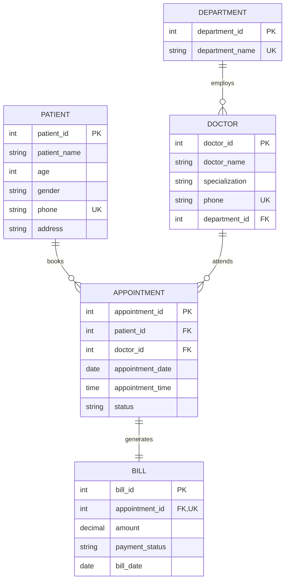

# MediCare - Hospital Patient & Appointment Management System

> **A Complete Healthcare SaaS & Academic DBMS Project**  
> Built with Java (Swing Desktop UI + built-in `HttpServer`), MySQL 8.0, and a Modern Responsive Web Dashboard.

[](https://www.oracle.com/java/)
[](https://www.mysql.com/)
[](https://developer.mozilla.org/en-US/)
[](https://vercel.com/)

---

## 🌟 Key Highlights

- **Dual-Mode Architecture**:
  - **Live Backend Mode**: Connected directly to MySQL 8.0 via JDBC and Java's built-in `com.sun.net.httpserver.HttpServer` on port `8080`.
  - **Vercel Cloud Demo Mode**: Automatic, graceful client-side fallback using `localStorage` seeded with the exact database records—allowing 100% interactive testing without a live MySQL instance.
- **Dual Client Interfaces**:
  1. **Java Swing Desktop Application**: Multi-window management system with forms for Patients, Doctors, Appointments, and Billing.
  2. **Modern Healthcare SaaS Web App**: Single-Page Dashboard featuring KPI cards, real-time tables, status pills, and toast notifications.
- **Enterprise-Grade Database Design**: Normalized relational schema with domain integrity constraints, referential integrity cascades, and strict check constraints.
- **ACID Transaction Billing**: Synchronous multi-table atomic updates via JDBC `setAutoCommit(false)`, `commit()`, and `rollback()`.
- **Zero External Dependencies**: Standard Java SE APIs only; no external JSON or web framework JARs required.

---

## 🏗️ 5-Table Relational Schema & ER Architecture



### Schema Integrity Constraints

1. **Department**: `department_name VARCHAR(50) NOT NULL UNIQUE`.
2. **Doctor**: Foreign key `department_id` references `Department(department_id)` with `ON DELETE RESTRICT ON UPDATE CASCADE`. Unique constraint on `phone`.
3. **Patient**: Check constraint `CHECK (age > 0 AND age <= 120)`. Check constraint `CHECK (gender IN ('Male', 'Female', 'Other'))`. Unique constraint on `phone`.
4. **Appointment**: Composite unique constraint `UNIQUE (doctor_id, appointment_date, appointment_time)`. Check constraint `CHECK (status IN ('Scheduled', 'Completed', 'Cancelled'))`.
5. **Bill**: `appointment_id` is unique (`1:1` relationship with Appointment). Check constraint `CHECK (amount >= 0)`. Check constraint `CHECK (payment_status IN ('Pending', 'Paid'))`.

---

## 🎓 DBMS Curriculum & Course Outcome (CO) Mapping

| Outcome | Title | Implementation in MediCare |
| :--- | :--- | :--- |
| **CO1** | **Relational Data Modeling & ER Design** | Entity-Relationship schema with Entities (`Patient`, `Doctor`, `Department`, `Appointment`, `Bill`), Primary Keys, and `1:N` & `1:1` cardinalities. |
| **CO2** | **DDL & Integrity Constraints** | `CREATE TABLE` scripts with `AUTO_INCREMENT`, `NOT NULL`, `UNIQUE`, `CHECK`, and `FOREIGN KEY ... ON UPDATE CASCADE`. |
| **CO3** | **Relational Algebra & Advanced SQL** | <ul><li>**3-Table JOIN**: `Appointment ⨝ Patient ⨝ Doctor`</li><li>**4-Table JOIN**: `Bill ⨝ Appointment ⨝ Patient ⨝ Doctor`</li><li>**Nested Subquery**: `WHERE appointment_id NOT IN (SELECT appointment_id FROM Bill)`</li><li>**Aggregates**: `COUNT(*)`, `SUM(amount)`, `AVG(amount)`</li><li>**GROUP BY & HAVING**: Doctors with at least 1 appointment</li></ul> |
| **CO4** | **Transaction Control Language (TCL) & ACID** | Atomicity demonstration during bill settlement: updates `Bill.payment_status = 'Paid'` and `Appointment.status = 'Completed'` inside a single transaction with automatic `rollback()` on failure. |
| **CO5** | **Normalization & Database Security** | Fully normalized up to BCNF/3NF eliminating redundancy and anomalies. DCL security script provided (`GRANT SELECT, INSERT, UPDATE, DELETE ON medicare.* TO 'medicare_app'@'localhost'`). |

---

## ⚡ Active SQL Queries Used

### 1. 3-Table INNER JOIN (Appointments)
```sql
SELECT A.appointment_id, P.patient_name, D.doctor_name, D.specialization,
       A.appointment_date, A.appointment_time, A.status
FROM Appointment A
JOIN Patient P ON A.patient_id = P.patient_id
JOIN Doctor D ON A.doctor_id = D.doctor_id
ORDER BY A.appointment_id DESC;
```

### 2. 4-Table INNER JOIN (Billing Ledger)
```sql
SELECT B.bill_id, B.appointment_id, P.patient_name, D.doctor_name,
       B.amount, B.payment_status, B.bill_date
FROM Bill B
JOIN Appointment A ON B.appointment_id = A.appointment_id
JOIN Patient P ON A.patient_id = P.patient_id
JOIN Doctor D ON A.doctor_id = D.doctor_id
ORDER BY B.bill_id DESC;
```

### 3. Nested Subquery (Unbilled Appointments)
```sql
SELECT A.appointment_id, P.patient_name, D.doctor_name, A.appointment_date
FROM Appointment A
JOIN Patient P ON A.patient_id = P.patient_id
JOIN Doctor D ON A.doctor_id = D.doctor_id
WHERE A.appointment_id NOT IN (
    SELECT appointment_id FROM Bill
)
ORDER BY A.appointment_id;
```

### 4. Aggregate Revenue Summary
```sql
SELECT COUNT(*) AS total_bills,
       IFNULL(SUM(amount), 0) AS total_revenue,
       IFNULL(AVG(amount), 0) AS avg_bill,
       COUNT(CASE WHEN payment_status = 'Paid' THEN 1 END) AS paid_bills,
       IFNULL(SUM(CASE WHEN payment_status = 'Paid' THEN amount ELSE 0 END), 0) AS paid_revenue
FROM Bill;
```

### 5. ACID Transaction (TCL)
```sql
START TRANSACTION;
UPDATE Bill SET payment_status = 'Paid' WHERE bill_id = ?;
UPDATE Appointment SET status = 'Completed' WHERE appointment_id = ?;
COMMIT; -- Rolled back if an exception occurs
```

---

## 🚀 How to Run

### Prerequisites
- **Java JDK 8 or higher** (`javac -version` and `java -version` accessible in PATH).
- **MySQL Server 8.0** running locally on port `3306`.
- **MySQL Connector/J JAR** located in `lib/mysql-connector-java.jar`.

### 1. Database Setup
1. Open MySQL Workbench or your MySQL CLI:
   ```bash
   mysql -u root -p
   ```
2. Execute the setup script:
   ```sql
   source sql/medicare_complete.sql;
   ```
3. Configure your credentials in `.env` (in the project root):
   ```env
   MYSQL_PASSWORD=your_mysql_password
   MYSQL_USER=root
   MYSQL_URL=jdbc:mysql://localhost:3306/medicare
   ```

### 2. Running the Web Application (Recommended)
Double-click `start_web.bat` in the project root, or execute:
```cmd
javac -cp "lib\mysql-connector-java.jar;src" src\*.java
java -cp "lib\mysql-connector-java.jar;src" WebServer
```
Then navigate to **`http://localhost:8080/`** in your browser.

### 3. Running the Desktop Swing Application
Double-click `run.bat` in the project root, or execute:
```cmd
javac -cp "lib\mysql-connector-java.jar;src" src\*.java
java -cp "lib\mysql-connector-java.jar;src" Main
```

---

## ☁️ Deploying to Vercel

The web interface is ready for static deployment on Vercel:

1. Push this repository to GitHub.
2. Import the repository in [Vercel](https://vercel.com/new).
3. Vercel automatically detects `vercel.json` and deploys `public/` at the root domain.
4. When hosted on Vercel, the app runs in **Cloud Demo Mode** with full interactivity, local state persistence, and ACID transaction simulation.

---

## 📁 Project Structure

```text
MediCare/
├── .env                  # MySQL local credentials (git-ignored)
├── .gitignore            # Git ignore rules for passwords and .class files
├── vercel.json           # Vercel deployment configuration
├── run.bat               # Desktop Swing Launcher script
├── start_web.bat         # Web Application Launcher script (Port 8080)
├── README.md             # Complete system documentation
├── lib/
│   └── mysql-connector-java.jar # JDBC Driver
├── sql/
│   └── medicare_complete.sql    # DDL, DML, TCL, DCL scripts
├── public/
│   ├── index.html        # Modern Healthcare SaaS Dashboard
│   ├── styles.css        # Responsive CSS Design System
│   └── app.js            # Dual-Mode Client & State Manager
└── src/
    ├── DBConnection.java     # JDBC connection manager with .env support
    ├── WebServer.java        # Built-in HttpServer REST API on port 8080
    ├── Main.java             # Swing main launcher
    ├── PatientForm.java      # Swing patient management form
    ├── DoctorForm.java       # Swing doctor management form
    ├── AppointmentForm.java  # Swing appointment booking form
    ├── BillingForm.java      # Swing billing & transaction form
    └── ConnectionTest.java   # Quick database connectivity test
```

---

## 👥 Contributors & Academic Credits
- **Project**: MediCare - Hospital Patient & Appointment Management System
- **Domain**: Relational Database Management Systems (DBMS), CO1-CO5 Curriculum
- **License**: MIT
